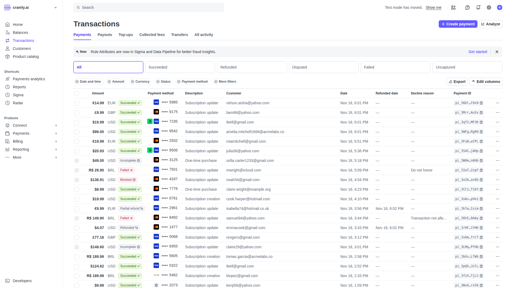
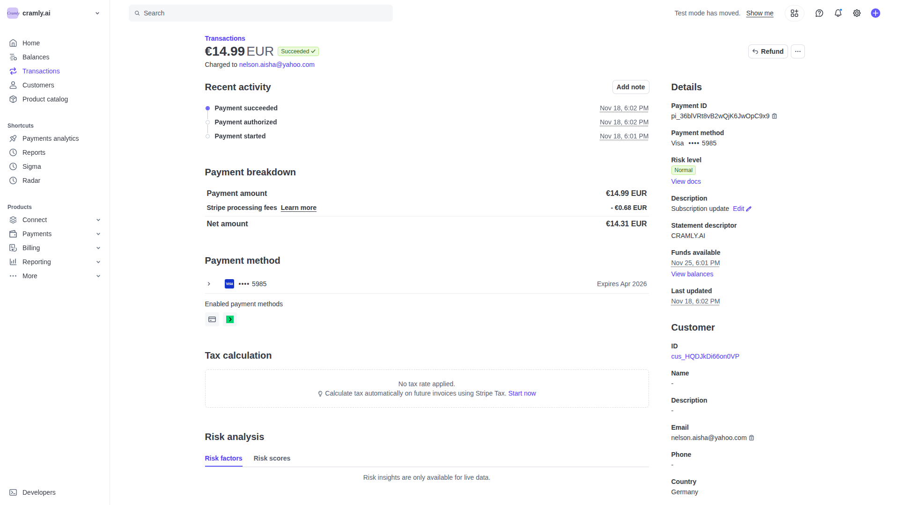
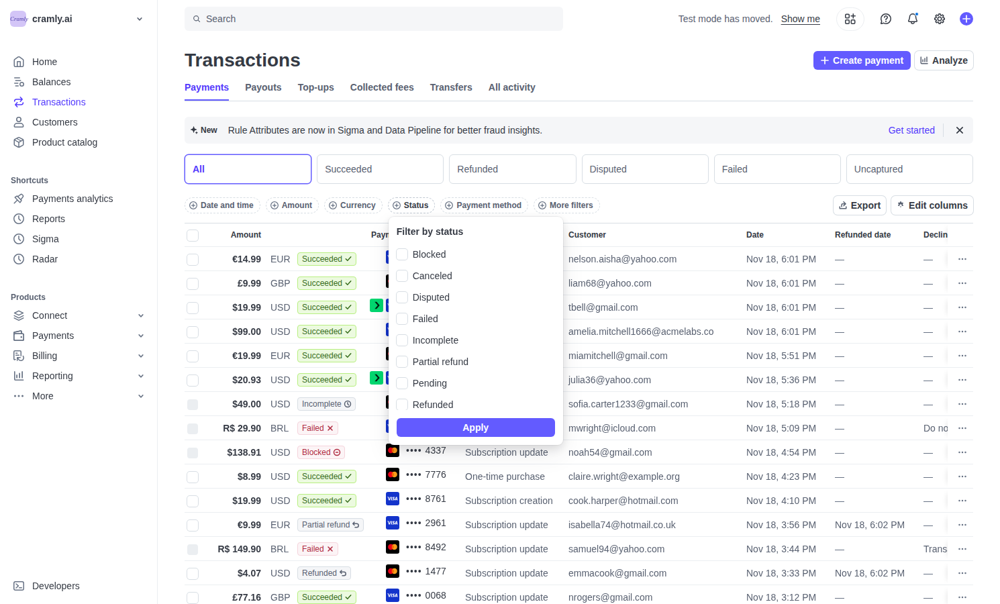
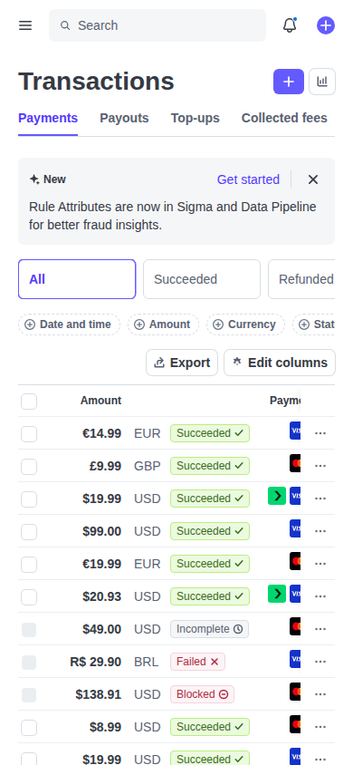

# Stripe Dashboard · Payments clone

A pixel-faithful rebuild of the Stripe Dashboard **Payments** screen (Transactions → Payments) and its
**Payment details** page, implemented twice, in **Next.js** and in **Angular**, both in TypeScript, on top of
one shared design system and one shared domain layer.



| Payment details                                       | Status filter                                 | Mobile                                              |
| ----------------------------------------------------- | --------------------------------------------- | --------------------------------------------------- |
|  |  |  |

## Features

- **Table columns:** Amount formatted with its currency and ISO code, status badge (Succeeded, Pending,
  Failed, Refunded, plus Partial refund, Canceled, Blocked, Uncaptured, Disputed and Incomplete), payment
  method (wallet mark, card brand, last 4), description, customer, created date with the relative time in a
  tooltip, refunded date, decline reason, and a shortened Payment ID with copy to clipboard.
- **Sorting:** by date, amount, status and customer. Shift+click (or Shift+Enter) adds secondary sorts.
  Mixed currencies are ordered by an approximate USD value.
- **Pagination:** 25, 50 or 100 rows per page, client-side.
- **Filters:**
  - Date range presets (Today, 7 days, 30 days, Custom)
  - Amount (equal to, between, greater than, less than)
  - Currency
  - Status (multi-select)
  - Payment method (Card, ACH Direct Debit, Wallet; multi-select)
  - Quick status views (All, Succeeded, Refunded, Disputed, Failed, Uncaptured)
  - Text search by payment ID, email or last 4 digits (`/` focuses it)
- **Shareable state:** every filter, sort and page lives in the URL.
- **States:** loading skeletons that reserve the final layout, an empty state with the Dashboard's copy,
  error states with retry, and an unknown-payment page.
- **Extras:**
  - Sidebar and top bar with search and an apps shortcut
  - Payment details route with timeline, breakdown, events, logs and metadata
  - CSV export of the current view
  - Column visibility ("Edit columns")
  - Responsive layout using the Dashboard's own breakpoints
- **Mock data:** 600 deterministic payments in 7 currencies, with realistic amounts, decline reasons,
  wallets and ACH payments.

## Running it

Requirements: Node ≥ 24.15 (see `.nvmrc`) and pnpm 12.

```bash
pnpm install
pnpm dev:next        # Next.js  → http://localhost:3000
pnpm dev:angular     # Angular  → http://localhost:4200

pnpm build           # build every package and both apps (Turborepo)
pnpm test            # domain unit tests (Vitest)
pnpm e2e             # the same Playwright suite against both apps
pnpm typecheck && pnpm lint
pnpm data            # regenerate the mock dataset (deterministic)
```

## Repository layout

```
apps/
  web-next/        Next.js App Router app            → apps/web-next/README.md
  web-angular/     Angular standalone/zoneless app   → apps/web-angular/README.md
packages/
  domain/          Types, formatting, status catalog, filter/sort/paginate engine, URL state (unit tested)
  styles/          Design tokens + component CSS shared by both apps
  icons/           SVG sources and a generated, typed icon registry
  mock-data/       Seeded generator, payments.json and lazily loaded detail shards
  e2e/             Playwright specs run against both apps
docs/
  planning/        Style guide, component map, architecture, roadmap
  reference/       Reference image, live captures, extracted icons, computed-style dump
```

## How the screen was mapped

The goal was to remove guesswork: every size, color and label in the code comes from a measurement or a
capture that is kept in `docs/reference`.

1. **A real account with every state.** A Stripe account in test mode was seeded through the API with
   test cards and payment methods. That produced succeeded, declined (insufficient funds, expired card,
   incorrect CVC…), blocked, canceled, uncaptured, refunded, partially refunded, disputed and incomplete
   payments, so every badge, decline reason and detail-page variant could be seen for real.
2. **The reference image is the target.** The brief's screenshot uses an older layout than today's
   Dashboard: wide status cards, dashed filter pills, Export / Edit columns, and badges with icons. I rebuilt that structure and used the live Dashboard for everything the image can't show.
3. **Measuring the reference.** The image is a scaled render, so the scale was derived from three
   independent anchors: the 16 px checkbox, the cap height of the 28 px title, and the table row pitch.
   All three agree on ≈1.375×, which puts the source viewport at about 1490 CSS px. With that factor, a
   script measured element boxes, text cap heights and baselines, and sampled colors (fills, borders,
   badge tones, text) directly from the pixels. That is where the 36 px rows and header, the 44 px status
   cards, the 24 px pills, the column x-positions and the older color palette come from.
4. **Measuring the live Dashboard.** At a 1920 px viewport, the DOM was inspected with computed styles and
   bounding boxes for typography, paddings, radii, shadows, row and badge metrics, and detail-page grid
   widths. The results are dumped to `docs/reference/raw/computed-styles.json`. SVG icons were extracted
   straight from the DOM.
5. **States, hovers, menus and filters.** Each interaction was opened and captured:
   - the filter menu and every filter popover (date operators and units, amount operators, the status
     list, payment method)
   - row hover with inline actions, and the "Copy to clipboard" tooltip
   - the row `⋯` menu
   - the detail page fully loaded and mid-load (a spinner per section)
   - the real empty state ("No results / No results match your criteria / Clear all")

   Filters also turned out to be kept in the URL, which I adopted.

6. **Responsive behavior.** Breakpoints were read from the Dashboard's own stylesheets: media queries
   ranked by rule count gave 490 / 768 / 1040 / 1440 px. They were then confirmed by resizing (sidebar
   becomes a drawer below 1040 px, gutters drop from 40 to 20 px, actions collapse on phones).
7. **Writing it down.** The findings became the planning documents: the
   [style guide](docs/planning/01-style-guide.md) (tokens, typography, spacing, states, verbatim copy), the
   [component map](docs/planning/02-component-map.md) (what repeats and becomes a component, with props
   and states), the [architecture](docs/planning/03-architecture.md) and the
   [roadmap and acceptance matrix](docs/planning/04-roadmap-and-acceptance.md).

## How the components were built

1. **Tokens first.** Colors, type scale, spacing, radii, shadows and breakpoints are CSS custom properties
   in `packages/styles/src/tokens.css`. Component CSS uses only tokens; no raw values are scattered around.
2. **One stylesheet, two frameworks.** Component styles are plain, framework-agnostic CSS with stable
   BEM-like classes (`.filter-pill`, `.data-table__cell`, `.badge--success`) in cascade layers. React and
   Angular render the same markup contract, so a spacing fix lands in both apps at once.
3. **Logic outside the UI.** Filtering, multi-column sorting, pagination, money and date formatting, status
   metadata, CSV export and URL (de)serialization are pure functions in `packages/domain`, covered by unit
   tests and shared by both apps. The UI layers only wire state to markup.
4. **Primitives → shell → features.** I built primitives first (icon, button, badge, checkbox, tooltip,
   popover, menu), then the shell (sidebar, top bar, search), then the features (status cards, filter
   pills and panels, table and cells, pagination, details sections). Each repeated element from the
   component map became one component with typed props/inputs.
5. **Accessibility built in.**
   - Real table semantics and `aria-sort`; row links that are keyboard-reachable with no nested
     interactive elements.
   - Popovers and menus manage focus: Floating UI in React, the CDK in Angular.
   - Tooltips open on hover _and_ focus, and relative times are also exposed to screen readers.
   - Visible `:focus-visible` rings.
6. **Performance and caching.**
   - The static shell is prerendered (Next.js Cache Components). Routes and filter panels are lazy
     (`next/dynamic` / `@defer`).
   - Payment details load from one of 16 shards only when needed, and are prefetched on row hover.
   - The dataset is cached in memory and persisted to IndexedDB. The data files are served with long-lived
     HTTP caching.
7. **Verification loop.**
   - Renders were overlaid on the scaled reference at its native 1490 px width, and spacing was adjusted
     until boxes, rows and text baselines lined up.
   - Each state was compared against the live captures.
   - The Playwright suite runs unchanged against both apps to prove feature parity.

### A note on fonts

Like the Dashboard, the UI uses the platform's system font stack (`-apple-system, BlinkMacSystemFont,
"Segoe UI", Roboto, …`). On macOS it renders with SF Pro, exactly like the reference. Other platforms
use their native UI font, so glyph widths differ slightly while the layout stays the same.

## Deployment (Railway)

Both apps deploy to [Railway](https://railway.com) as two services of the same project, built from the
repository root so the pnpm workspace installs once. Point each service at its config file
(Settings → Config-as-code):

| Service | Config file                     | Build                                       | Start                                                         |
| ------- | ------------------------------- | ------------------------------------------- | ------------------------------------------------------------- |
| Next.js | `apps/web-next/railway.json`    | `pnpm turbo run build --filter=web-next`    | `pnpm --filter web-next start` (listens on `$PORT`)           |
| Angular | `apps/web-angular/railway.json` | `pnpm turbo run build --filter=web-angular` | `npx serve -s` on the build output (single-page-app fallback) |

Railway reads the Node version from `.nvmrc` / `engines` and uses pnpm from `packageManager`.
